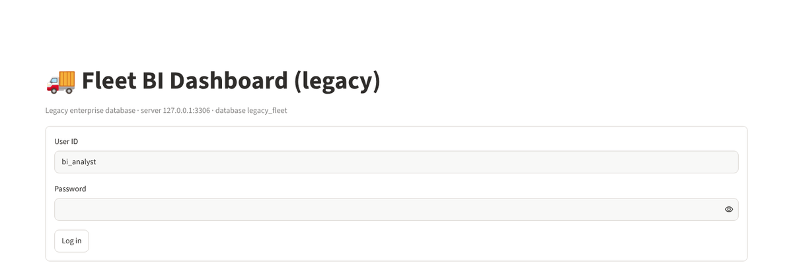
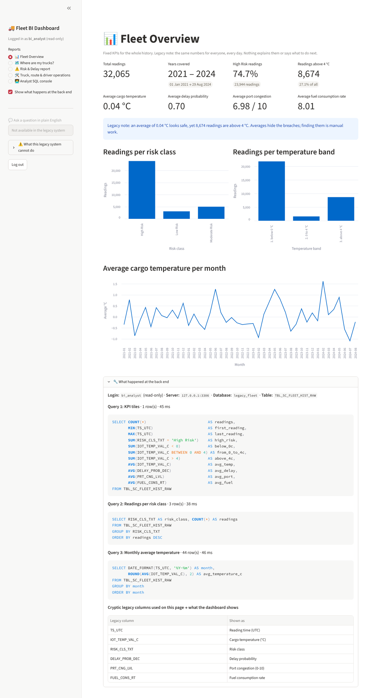
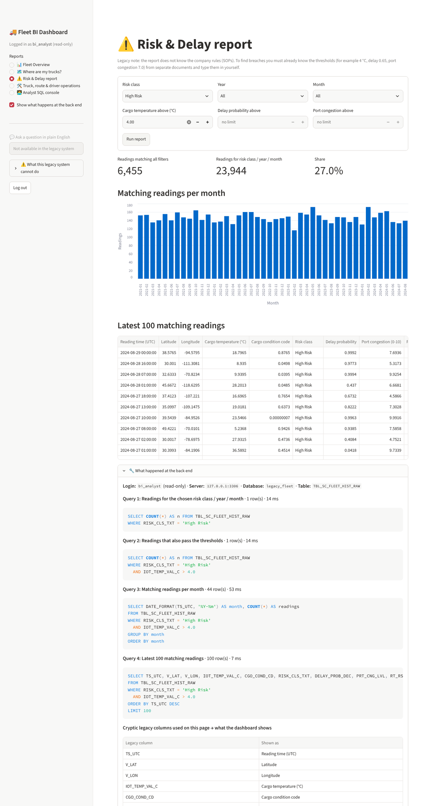
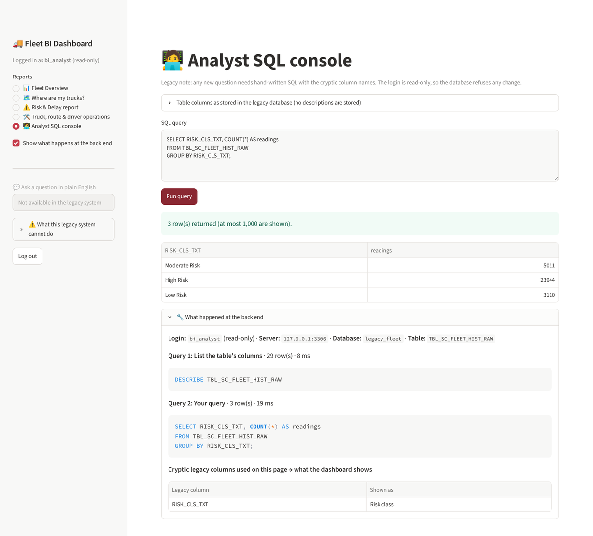
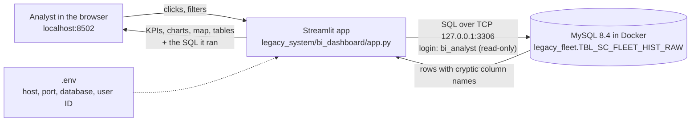

# Step 2: Legacy BI Dashboard Guide (Windows first, then macOS)

**Project:** Cold-Chain Logistics FDE (FDE_PB_Sol)
**What you build:** the **BI Dashboard** of the legacy system (Part 1 of the architecture diagram), a simple Streamlit web app on top of the Step 1 MySQL database
**Platforms:** **Windows 10/11 with PowerShell (primary)** · macOS with Terminal
**Needs:** Step 1 finished (`docs/01_Legacy_System_Setup_Guide.md`) and the `fde-mysql` container running
**Version:** 1.0, 24 Nov 2026

---

## 0. What this step adds (summary)

In the legacy world, a business analyst asks *"Where are my trucks? Any risk?"* and answers it **by hand**: they log in to a BI dashboard with an ID and password, pick filters from fixed drop-downs, read static charts and KPIs, and for anything new they write SQL against cryptic column names. This step builds exactly that, so you can see and demonstrate how the legacy system works **before** the AI system replaces the manual steps.

| Item | Value |
|---|---|
| App | `legacy_system/bi_dashboard/app.py`: one Python file with 5 numbered sections and comments |
| Opens at | <http://localhost:8502> (reachable from this computer only) |
| Logs in as | `bi_analyst`, the read-only login from Step 1; it can never change data |
| Reads | the raw legacy table `legacy_fleet.TBL_SC_FLEET_HIST_RAW` with its cryptic column names |
| Columns used | the **9 core columns** (the same 9 the AI system will use) plus **8 operations columns** (fuel, ETA, traffic, driver behaviour and fatigue, stored weather severity, delivery deviation, shipping cost) |
| Screens | Login · Fleet Overview · Where are my trucks? · Risk & Delay report · Truck, route & driver operations · Analyst SQL console |
| Shows the back end | Every screen has a panel **"What happened at the back end"** with the login used, the exact SQL sent to MySQL, rows returned, time taken, and which cryptic columns were turned into which labels |
| Deliberately missing | Plain-English questions, live weather, company SOPs, explanations or recommended actions, and an audit trail. These are the gaps that the AI system fills later. |

**Decisions taken**

| # | Decision | Why |
|---|---|---|
| 1 | **Streamlit 1.67.0** with only its built-in charts and map | Simple code; the same Streamlit version as the HLD, so the later AI console uses the same tool |
| 2 | **A login screen** asks for the `bi_analyst` password | This is how users reach a legacy system: ID and password only, no API |
| 3 | **The raw table** is read, not a readable view | The readable view (`vw_active_fleet`) belongs to the AI step; the legacy dashboard lives with the cryptic names |
| 4 | **Port 8502, local only** | The HLD's AI console uses 8501, so both can later run side by side for a before/after demo |
| 5 | **8 extra columns** on an Operations screen | They match the diagram's *Truck sensors* (fuel) and *Route telemetry* (travel-time variation, traffic) boxes, plus driver and delivery measures |
| 6 | Its own Python environment, **`venv_legacy`** | Keeps the dashboard's packages separate from the AI solution's later environment |

---

## How to use this guide

- Same conventions as Step 1. **Windows (PowerShell)** blocks are the main path; **macOS (Terminal)** blocks follow them.
- Platform blocks start by moving to the project folder:
  - Windows: `Set-Location "$([Environment]::GetFolderPath('MyDocuments'))\FDE_PB_Sol"` (if your project is elsewhere, use `Set-Location "<your path>"`)
  - macOS: `cd ~/Documents/FDE_PB_Sol`
- You never "activate" the virtual environment. Each command calls its Python directly (`.\venv_legacy\Scripts\python.exe` on Windows, `./venv_legacy/bin/python` on macOS), which avoids PowerShell's script-blocking rules.
- Output labels: ***captured*** means real output from the tested app; ***example*** means typical output, which will differ on your computer.

---

## Part A: Install Python 3.12

### A1. Check whether Python 3.12 is installed

**Windows (PowerShell)**
```powershell
Set-Location "$([Environment]::GetFolderPath('MyDocuments'))\FDE_PB_Sol"
if (Get-Command py -ErrorAction SilentlyContinue) { py -3.12 --version } else { "Python launcher (py) NOT found - do step A2" }
```

**macOS (Terminal)**
```bash
cd ~/Documents/FDE_PB_Sol
command -v python3.12 >/dev/null && python3.12 --version || echo "Python 3.12 NOT found - do step A2"
```

**Expected output** (*example*): `Python 3.12.10`. Any 3.12.x is fine. If you see *NOT found*, or on Windows `No suitable Python runtime found`, do **A2**. (Python 3.11 or 3.13 also work; replace `3.12` with your version in the commands below.)

### A2. Install Python 3.12 (skip if A1 showed a version)

**Windows (PowerShell)**
```powershell
Set-Location "$([Environment]::GetFolderPath('MyDocuments'))\FDE_PB_Sol"
winget install -e --id Python.Python.3.12 --accept-package-agreements --accept-source-agreements
```

**macOS (Terminal)**
```bash
cd ~/Documents/FDE_PB_Sol
brew install python@3.12
```

**Expected output** (*example*): Windows `Successfully installed`; macOS `🍺  /opt/homebrew/Cellar/python@3.12/...`. **On Windows, open a new PowerShell window afterwards** and run **A1** again.

---

## Part B: Create the dashboard's Python environment

### B1. Create `venv_legacy` and install the packages

**What it does:** Creates a private Python environment called `venv_legacy` in the project folder and installs the 6 pinned packages from `legacy_system/bi_dashboard/requirements.txt` (Streamlit, pandas, SQLAlchemy, PyMySQL, cryptography, python-dotenv). This takes 1–3 minutes. It is safe to run again.

**Windows (PowerShell)**
```powershell
Set-Location "$([Environment]::GetFolderPath('MyDocuments'))\FDE_PB_Sol"
py -3.12 -m venv venv_legacy
.\venv_legacy\Scripts\python.exe -m pip install --upgrade pip
.\venv_legacy\Scripts\python.exe -m pip install -r legacy_system\bi_dashboard\requirements.txt
```

**macOS (Terminal)**
```bash
cd ~/Documents/FDE_PB_Sol
python3.12 -m venv venv_legacy
./venv_legacy/bin/python -m pip install --upgrade pip
./venv_legacy/bin/python -m pip install -r legacy_system/bi_dashboard/requirements.txt
```

**Expected output** (*example*, last line):

```text
Successfully installed altair-... pandas-3.1.1 ... PyMySQL-1.2.4 ... SQLAlchemy-2.1.9 ... streamlit-1.67.0 ...
```

### B2. Check the installation

**Windows (PowerShell)**
```powershell
Set-Location "$([Environment]::GetFolderPath('MyDocuments'))\FDE_PB_Sol"
.\venv_legacy\Scripts\python.exe -c "import streamlit, pandas, sqlalchemy, pymysql, dotenv; print('streamlit', streamlit.__version__, '| pandas', pandas.__version__, '| SQLAlchemy', sqlalchemy.__version__)"
```

**macOS (Terminal)**
```bash
cd ~/Documents/FDE_PB_Sol
./venv_legacy/bin/python -c "import streamlit, pandas, sqlalchemy, pymysql, dotenv; print('streamlit', streamlit.__version__, '| pandas', pandas.__version__, '| SQLAlchemy', sqlalchemy.__version__)"
```

**Expected output** (*captured*):

```text
streamlit 1.67.0 | pandas 3.1.1 | SQLAlchemy 2.1.9
```

---

## Part C: Start the dashboard

### C1. Make sure the legacy database is running

Start Docker Desktop first if it is not running (Step 1, **C4**), then:

**Windows (PowerShell)**
```powershell
Set-Location "$([Environment]::GetFolderPath('MyDocuments'))\FDE_PB_Sol"
docker compose -f legacy_system/docker-compose.yml --env-file .env up -d --wait
```

**macOS (Terminal)**
```bash
cd ~/Documents/FDE_PB_Sol
docker compose -f legacy_system/docker-compose.yml --env-file .env up -d --wait
```

**Expected output** (*example*): `✔ Container fde-mysql  Healthy`

### C2. Start the dashboard

**What it does:** Starts the Streamlit web server on port 8502, reachable only from this computer. The options switch off Streamlit's first-run e-mail prompt, its usage statistics and its developer *Deploy* button. **Leave this window open**: the dashboard runs as long as the window does. Press **Ctrl + C** in it to stop the dashboard.

**Windows (PowerShell)**
```powershell
Set-Location "$([Environment]::GetFolderPath('MyDocuments'))\FDE_PB_Sol"
.\venv_legacy\Scripts\python.exe -m streamlit run legacy_system/bi_dashboard/app.py --server.port 8502 --server.address localhost --server.headless true --browser.gatherUsageStats false --client.toolbarMode minimal
```

**macOS (Terminal)**
```bash
cd ~/Documents/FDE_PB_Sol
./venv_legacy/bin/python -m streamlit run legacy_system/bi_dashboard/app.py --server.port 8502 --server.address localhost --server.headless true --browser.gatherUsageStats false --client.toolbarMode minimal
```

**Expected output** (*captured*):

```text
  You can now view your Streamlit app in your browser.

  URL: http://localhost:8502
```

### C3. Open the dashboard and log in

Open <http://localhost:8502> in your browser. You can also run `Start-Process http://localhost:8502` in a **second** PowerShell window (Windows), or `open http://localhost:8502` in a second Terminal window (macOS).

Log in with:
- **User ID:** `bi_analyst` (already filled in)
- **Password:** the `bi_analyst` password you chose in Step 1, D1. It is the `BI_ANALYST_PASSWORD` line in `.env`, which you can open with `notepad .env` (Windows) or `nano .env` (macOS).



---

## Part D: The screens

The sidebar on the left holds the **Reports** menu, the check box **Show what happens at the back end** (on by default), a greyed-out **"Ask a question in plain English"** box (*not available in the legacy system*), a list of **what this legacy system cannot do**, and **Log out**.

| Screen | What you see | Columns used | Legacy limitation it shows |
|---|---|---|---|
| **📊 Fleet Overview** | 8 KPI tiles (total readings, years covered, High Risk share, readings above 4 °C, average temperature, average delay probability, average port congestion, average fuel consumption rate), readings per risk class, readings per temperature band, average temperature per month | TS_UTC, IOT_TEMP_VAL_C, RISK_CLS_TXT, DELAY_PROB_DEC, PRT_CNG_LVL, FUEL_CONS_RT | Fixed numbers for everyone; **the averages hide the breaches** (0.04 °C on average, yet 8,674 readings above 4 °C) |
| **🗺️ Where are my trucks?** | Date range, risk class and a latitude/longitude box → count, map with coloured dots (🔴 High, 🟠 Moderate, 🟢 Low) and a table of up to 500 readings | The 9 core columns | Only coordinates and dates are understood (no place names such as "Los Angeles"), no truck ID, historical positions only, no weather |
| **⚠️ Risk & Delay report** | Risk class, year and month drop-downs plus three optional limits (temperature above, delay probability above, port congestion above) → counts, share, matching readings per month, the latest 100 matches | The 9 core columns | The report does not know the SOP rules; **you** must know and type the thresholds (4 °C, 0.65, 7.0) |
| **🛠️ Truck, route & driver operations** | Year drop-down → 8 averages, plus a monthly trend of any chosen measure | FUEL_CONS_RT, ETA_VAR_HRS, TRF_CNG_LVL, DRV_BHV_SCR, DRV_FTG_SCR, WX_SEV_IDX, DLV_TM_DEV, SHP_CST_AMT | Static averages only; the "weather severity" is a stored historical index, not live weather |
| **🧑‍💻 Analyst SQL console** | A box for your own SQL → result table (up to 1,000 rows); the table's columns as stored (cryptic names, no descriptions) | Any | Every new question needs hand-written SQL with cryptic names; the database refuses any change |

**Fleet Overview, with the back-end panel open at the bottom** (*captured*):



**Risk & Delay report for "High Risk" and "temperature above 4"** (*captured*):



**Analyst SQL console** (*captured*):



> **The map background** (streets and coastlines) is downloaded from the internet when the page opens. Without internet you still see the coloured dots, on a blank background.

---

## Part E: Sample inputs to test the system

Run these in order after logging in. The expected results were computed from the CSV and confirmed by an automated run of the dashboard (Appendix C). Afterwards, open **🔧 What happened at the back end** at the bottom of each screen to see the SQL that produced the result.

| # | Question a dispatcher would ask | What you do | Expected result (*captured*) |
|---|---|---|---|
| 0 | *(login check)* | On the login screen, type a wrong password and click **Log in** | `Login failed: (1045, "Access denied for user 'bi_analyst'…")`. Then log in with the right password. |
| 1 | How much data do we have? | **📊 Fleet Overview** | **Total readings 32,065**; **Years covered 2021 – 2024** (01 Jan 2021 → 29 Aug 2024) |
| 2 | Is the fleet temperature OK? | **📊 Fleet Overview** | **Average cargo temperature 0.04 °C** looks fine, but **Readings above 4 °C: 8,674** (27.1% of all). **High Risk readings: 74.7%** (23,944). |
| 3 | Show trucks near Los Angeles | **🗺️ Where are my trucks?** Date range **2021/01/01 – 2024/08/29**, Latitude from **33.3** to **34.3**, Longitude from **-118.6** to **-117.6** → **Run report** | **Matching readings 35**. The first table row is **2024-08-16 06:00**, about **-9.98 °C**, **High Risk**. |
| 4 | What happened in the last 24 hours? | **🗺️ Where are my trucks?** Date range **2024/08/28 – 2024/08/29**, latitude **30 to 50**, longitude **-120 to -70** → **Run report** | **Matching readings 25**: 20 of them High Risk and 5 above 4 °C |
| 5 | Which High Risk shipments are above 4 °C? | **⚠️ Risk & Delay report** Risk class **High Risk**, *Cargo temperature above* **4** → **Run report** | **Readings matching all filters 6,455** (27.0% of 23,944 High Risk readings). The latest is **2024-08-29 00:00** at **18.80 °C**. |
| 6 | Which need Tier 2 escalation? (SOP: High Risk and delay above 0.65; the dashboard does not know this) | **⚠️ Risk & Delay report** Risk class **High Risk**, clear the temperature box, *Delay probability above* **0.65** → **Run report**. Then also type temperature **4** → **Run report** | **15,440**, then **4,209** (also above 4 °C) |
| 7 | How often is the port congested? (SOP: above 7.0) | **⚠️ Risk & Delay report** Risk class **All**, clear the other boxes, *Port congestion above* **7** → **Run report** | **19,566** |
| 8 | How tired are the drivers in 2023? | **🛠️ Truck, route & driver operations** Year **2023**, then Measure **Driver fatigue score (0-1)** | **Readings in the selection 8,760**; a monthly fatigue trend |
| 9 | Count readings per risk class with my own SQL | **🧑‍💻 Analyst SQL console** → **Run query** (the example query is already filled in) | 3 rows: High Risk **23,944**, Moderate Risk **5,011**, Low Risk **3,110** (the row order may vary) |
| 10 | Can I change data? | **🧑‍💻 Analyst SQL console** Replace the query with `DELETE FROM TBL_SC_FLEET_HIST_RAW WHERE REC_ID = 1;` → **Run query** | Refused: `MySQL refused the query: (1142, "DELETE command denied to user 'bi_analyst'…")` |
| 11 | Is there a heatwave near Los Angeles right now, and what does our SOP say? | Try to ask it anywhere | **Not possible.** The plain-English box is disabled, and there is no live weather and no SOP access. This is the gap the AI system closes in the next steps. |

**More SQL to try in the console** (*captured* results):

```sql
SELECT YEAR(TS_UTC) AS yr, COUNT(*) AS readings FROM TBL_SC_FLEET_HIST_RAW GROUP BY yr;
```
→ 4 rows: 2021 = 8760 · 2022 = 8760 · 2023 = 8760 · 2024 = 5785

```sql
SELECT TS_UTC, V_LAT, V_LON, IOT_TEMP_VAL_C, RISK_CLS_TXT, DELAY_PROB_DEC FROM TBL_SC_FLEET_HIST_RAW ORDER BY TS_UTC DESC LIMIT 3;
```
→ the 3 latest readings, starting with 2024-08-29 00:00, 18.80 °C, High Risk

---

## Part F: How it works (what happens at the back end)



1. **Login:** `app.py` reads host, port, database and the default user ID from `.env`. **The password is typed by the user** and is not read from `.env`. If MySQL accepts it, the connection is kept for that browser session.
2. **Every click re-runs the script:** Streamlit runs `app.py` from top to bottom each time you change something. The chosen screen builds its SQL from your filters and sends it to MySQL with `run_query()`.
3. **Read-only by design:** MySQL itself refuses anything but reading for `bi_analyst`, so even the SQL console cannot change data.
4. **Labels:** the database returns cryptic names (`IOT_TEMP_VAL_C`); the app turns them into labels (`Cargo temperature (°C)`) using one dictionary, `LABELS`, at the top of `app.py`.
5. **The back-end panel:** each query is recorded (purpose, SQL with your values filled in, rows, milliseconds) and shown at the bottom of the screen.

**Code map of `app.py`:**

| Section | What it contains |
|---|---|
| 1. Settings | Reads `.env`; `LABELS` (cryptic name → label); the 9 core and 8 operations columns |
| 2. Database helpers | `connect()` for the login, `run_query()` to run and record a query, `backend_panel()` |
| 3. Login screen | `login_page()` |
| 4. Report pages | `page_overview()`, `page_map()`, `page_risk()`, `page_operations()`, `page_sql_console()` |
| 5. Main | Login first, then the sidebar and the chosen page |

---

## Part G: Daily use

**Start:** Docker Desktop → **C1** → **C2** → open <http://localhost:8502> → log in.

**Stop:** press **Ctrl + C** in the window running the dashboard. Optionally stop MySQL too (Step 1, **I1**).

**After editing `app.py`:** save the file; the browser offers **Rerun** at the top right, or you can press **R** in the page.

---

## Part H: Troubleshooting

| # | Platform | You see | Why | Fix |
|---|---|---|---|---|
| H1 | Both | `Login failed: (1045, "Access denied for user 'bi_analyst'…")` | Wrong password | Use the `BI_ANALYST_PASSWORD` from `.env`. If you changed `.env` later, run Step 1 **I5** |
| H2 | Both | `Login failed: (2003, "Can't connect to MySQL server on '127.0.0.1'…")` | The `fde-mysql` container is not running | Start Docker Desktop, then **C1** |
| H3 | Windows | `py : The term 'py' is not recognized` or `No suitable Python runtime found` | Python is not installed, or the window was opened before the install | Do **A2**, then open a new PowerShell window |
| H4 | Both | `No module named streamlit` | The packages are not installed in `venv_legacy`, or another Python was used | Run **B1** again, and start the app with the exact **C2** command |
| H5 | Both | `Port 8502 is already in use` | The dashboard is already running in another window, or another program uses 8502 | Use the running one, close it with Ctrl + C, or change `--server.port 8502` to `--server.port 8503` and open <http://localhost:8503> |
| H6 | Both | The browser shows *This site can't be reached* | The C2 window was closed, or the dashboard was stopped | Run **C2** again and keep that window open |
| H7 | Both | Map dots on a blank background | The map background needs internet | Connect to the internet; the dots and the table work without it |
| H8 | Windows | `cannot be loaded because running scripts is disabled` | You tried to *activate* the virtual environment | Not needed: use the commands exactly as written; they call `venv_legacy`'s Python directly |
| H9 | Both | `pip` cannot download packages | No internet, or a company proxy | Check the connection or VPN; with a proxy, add `--proxy http://<proxy>:<port>` to the pip command |
| H10 | Both | A report shows **0** matching readings | The filters exclude everything (for example a latitude box with *from* larger than *to*, or a date outside 2021–2024) | Check the filter values; the data covers 1 Jan 2021 to 29 Aug 2024 only |
| H11 | Both | `MySQL refused the query: (1064, … SQL syntax …)` in the console | A typing error in your SQL | Fix the SQL; column names are in the console's *Table columns* list and in Step 1, Appendix A |

---

## Appendix A: Files created in Step 2

| File | Purpose |
|---|---|
| `legacy_system/bi_dashboard/app.py` | The dashboard: login, 5 report screens, back-end panel |
| `legacy_system/bi_dashboard/requirements.txt` | 6 pinned packages: streamlit 1.67.0, pandas 3.1.1, SQLAlchemy 2.1.9, PyMySQL 1.2.4, cryptography 50.0.2, python-dotenv 1.2.4 |
| `docs/02_Legacy_BI_Dashboard_Guide.md` | This guide |
| `docs/images/step2/*.png` | Screenshots used in this guide |
| `venv_legacy/` | Created by you in **B1**; not part of the project files (git-ignored) |

## Appendix B: What was tested

| Item | How | Result |
|---|---|---|
| All screens and sample inputs 0–10 | Automated run with Streamlit's built-in test runner (`AppTest`) against MySQL 8.0.46 loaded with the real CSV (Python 3.13 on Linux, the pinned packages) | **34 of 34 checks passed**; every expected value in Part E matched |
| Expected values | Computed separately from the CSV in Python | Identical to the dashboard's results |
| The real web app | Started with the exact **C2** options and opened in Chrome; every screen viewed and screenshotted | All screens render; no errors |
| Read-only safety | `DELETE` in the SQL console; wrong password at login | Refused (1142); login refused (1045) |
| **Not run** | The Windows and macOS commands in Parts A–C (Python install, `venv_legacy`, starting the app on your computer); the map background (no internet in the test environment) | Their outputs are marked *example* |
