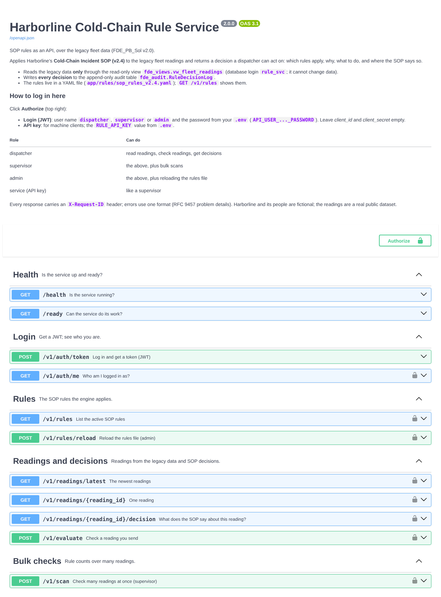
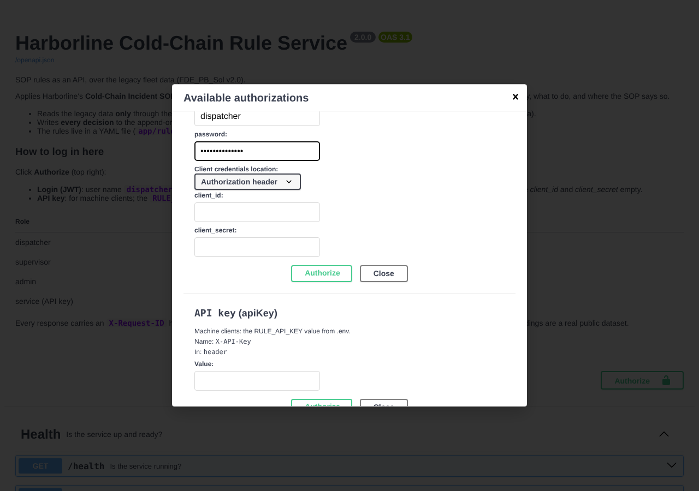
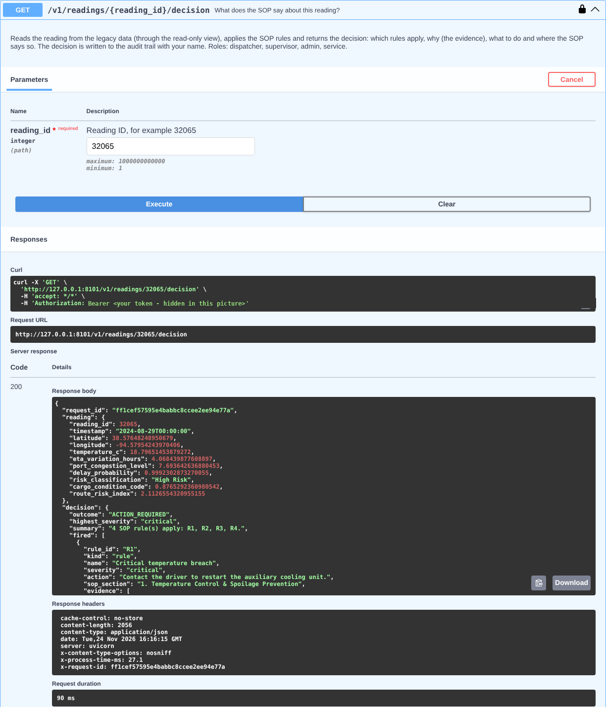

# Step 4: Rule Service API Guide (Windows first, then macOS)

**Project:** Cold-Chain Logistics FDE (FDE_PB_Sol)
**Version of the project:** v2.0 Engineering Core, Step 4 of 4
**What you build:** a FastAPI service that applies the company's SOP rules to the legacy readings and answers over a JSON API. It has logins (JWT for people, an API key for programs), Swagger documentation, tests, and a Docker container next to the legacy MySQL.
**Platforms:** **Windows 10/11 with PowerShell (primary)** · macOS with Terminal
**Guide version:** 1.0, 24 Nov 2026

| Version | Date | Change |
|---|---|---|
| 1.0 | 24 Nov 2026 | First version |

---

## 0. What Step 4 adds (summary)

**Status:** built and tested in the build environment. The 53 unit and API tests and the 2 integration tests against the real data passed, and every endpoint was called against MySQL. **Waiting for you to run it.**

**The idea in one sentence:** the SOP rules become a small, reliable service. You give it a reading (or a reading number) and it tells you which SOP rules apply, why, what to do, and where the SOP says so. It also records who asked.

```text
 people: browser (Swagger), PowerShell, curl         programs: rule_client.py (later the v3.0 AI)
          | login -> JWT "visitor badge"                      | X-API-Key
          +----------------------+----------------------------+
                                 v
     rule service  (FastAPI in Docker container fde-rule-service, http://127.0.0.1:8101)
       1. who is calling, and may this role do this?           (JWT / API key, roles)
       2. is the request correct?                              (Pydantic: 422 if not)
       3. read the reading through the safe view               (Step 3 login rule_svc)
       4. apply sop_rules_v2.4.yaml                            (rule engine)
       5. write an audit row: who, what, which rules, answer   (append-only)
       6. answer in JSON (errors in one standard format)
                                 |
                                 v
     fde_views.vw_fleet_readings -> legacy table (unchanged)      fde_audit.RuleDecisionLog
```

**Endpoints**

| Method and path | Who may call it | What it does |
|---|---|---|
| `GET /health` | anyone | Is the service running? |
| `GET /ready` | anyone | Are the rules loaded and is the database reachable? 503 if not. |
| `POST /v1/auth/token` | anyone | Log in with user name and password; returns a JWT |
| `GET /v1/auth/me` | logged in | Who am I logged in as? |
| `GET /v1/rules` | logged in | The active SOP rules |
| `POST /v1/rules/reload` | admin | Reload the rules file after editing it |
| `GET /v1/readings/latest` | logged in | Newest readings, optionally in a latitude/longitude box |
| `GET /v1/readings/{id}` | logged in | One reading, with readable names |
| `GET /v1/readings/{id}/decision` | dispatcher, supervisor, admin, service | **What does the SOP say about this reading?** (audited) |
| `POST /v1/evaluate` | logged in | The same check for a reading you send, for example one read out on the phone (audited) |
| `POST /v1/scan` | supervisor, admin, service | Rule counts over a time window or area, plus the newest cases (audited) |

**Logins and roles**

| User / login | Role | Can do |
|---|---|---|
| `dispatcher` (password in `.env`) | dispatcher | read readings, check readings, get decisions |
| `supervisor` | supervisor | the above, plus bulk scans |
| `admin` | admin | the above, plus reloading the rules file |
| API key (`RULE_API_KEY` in `.env`) | service | like a supervisor; for programs, not people |

**Decisions taken**

| # | Decision | Why |
|---|---|---|
| 1 | **FastAPI** with **async** routes and database calls | Clear routes, automatic Swagger/OpenAPI, and one slow query does not block other callers. |
| 2 | **Pydantic** models for every request and response | Wrong input is refused with 422 and a list of what is wrong, before any code runs. The same models are the documented JSON contract. |
| 3 | Rules in a **YAML file**, read by a small tested engine | Operations can read the rules, a change needs no code, and a file with mistakes is refused (Part I). |
| 4 | The same YAML rule is also turned into **parameterised SQL** for scans | Counting 32,065 readings happens inside MySQL (about 50 ms). Values are never pasted into SQL text. |
| 5 | **JWT for people, API key for programs, four roles** | A name and role on every audit row (story rule C3). Programs such as the v3.0 AI get their own key. |
| 6 | One error format: **RFC 9457 problem details** | Every error has a status, a title, a plain explanation and a request ID. |
| 7 | A **request ID** on every answer, log line and audit row | One call can be followed end to end, also across services. |
| 8 | **Audit writes never block an answer** | During an incident the dispatcher still gets the decision; `audit_logged: false` shows the row is missing. |
| 9 | **Docker**, joined to the legacy MySQL network, published on **127.0.0.1** only | Runs next to the legacy system, like a real deployment, but cannot be reached from your network. |
| 10 | The container gets **only the settings it needs** | The MySQL root password and the bi_analyst password never enter the service container. |
| 11 | **Exact package versions**, checked on PyPI on 24 Nov 2026 | The same result on every machine (Appendix D). |
| 12 | Tests at three levels: rule edges, API, and a **reconciliation** with the real data | The Python engine, the SQL form and the Step 3 counts must all agree. |
| 13 | **R3 applies to all readings**; the assumption is stated in every R3 answer | Your decision of 24 Nov 2026. The data has no port name. |
| 14 | **G1 (below 0 °C) is reported as an SOP gap**, never given an invented action | The SOP has no rule there; a human decides. |

**Your topic list, and where to see each topic**

| Topic | Where in this step |
|---|---|
| REST, HTTP methods, status codes, request-response flow | Part G2 (raw calls: 200, 401, 403, 404, 422, 503) and Part F4 |
| JSON endpoints with clear contracts | `docs/api/Rule_Service_API_Contract_v2.0.md` and `docs/api/openapi.json`; Part F |
| FastAPI: routes, dependencies, async | `app/routers/`, `app/deps.py`, `app/security.py`, `app/repository.py` |
| Pydantic validation | `app/schemas.py`; Part F4 items 6 and 13; Part G2 |
| Authentication: API keys, JWT | Parts F2, G1, G2; `app/security.py` |
| Error handling, exceptions, API testing | `app/errors.py`; Part D (55 tests); Part G3 (database down) |
| Swagger / OpenAPI | Part F (`/docs`, `/redoc`); `scripts/export_openapi.py` |
| Microservices and service-to-service calls | Part G1 (client with API key, timeouts, retries, request ID); Part K |

**The numbers the service reproduces** (*captured*, through the API, over all 32,065 readings):

| R1 breach > 4 °C | R2 breach and > 1 h late | R3 port > 7 | R4 Tier 2 | G1 below 0 °C (gap) | Outcomes |
|---|---|---|---|---|---|
| 8,674 | 6,621 | 19,566 | 15,440 | 21,817 | ACTION_REQUIRED 27,245 · REVIEW 4,524 · NO_ACTION 296 |

The rule counts are the same as the Step 3 self-test. The three outcome numbers were also computed straight from the CSV, without the service, and match.

---

## How to use this guide

- **Before you start:**
  - Step 3 passes (17 of 17).
  - **Docker Desktop is running.**
  - Python 3.12 is installed (Step 2, A1).
- The conventions are the same as in Steps 1–3:
  - Work through the parts **in order**. Each step has three parts: **What it does** → **Command** → **Expected output**.
  - **Windows (PowerShell)** blocks are the main path; **macOS (Terminal)** blocks follow.
  - Each block starts by moving to the project folder.
- Labels on expected output:
  - ***captured*** = the real output in the build environment (Linux, Python 3.12.3, MySQL 8.0.46). Times, request IDs and tokens differ on your computer.
  - ***example*** = typical output that could not be produced there (Docker build, PowerShell).
- **Run the Part G2 PowerShell blocks in the same window.** They reuse the login (`$h`) from the block before.

---

## Part A: Check the starting point

### A1. MySQL is running and Step 3 still passes

**What it does:** Shows the legacy container and re-runs the Step 3 self-test. The self-test adds one `SELF_TEST` audit row.

**Windows and macOS (same commands)**
```text
docker ps --filter name=fde-mysql --format "{{.Names}}  {{.Status}}"
docker exec fde-mysql sh /scripts/07_verify_integration.sh
```

**Expected output:**
- `fde-mysql  Up … (healthy)` (*example*).
- The self-test ends with `RESULT: 17 of 17 checks passed. The integration layer is ready for the rule service.` (*captured*).

If MySQL is not running, start it (Step 1, **I2**). If the self-test does not pass, fix Step 3 first.

### A2. Python 3.12 is available

**Windows (PowerShell)**
```powershell
Set-Location "$([Environment]::GetFolderPath('MyDocuments'))\FDE_PB_Sol"
py -3.12 --version
```

**macOS (Terminal)**
```bash
cd ~/Documents/FDE_PB_Sol
python3.12 --version
```

**Expected output** (*example*): `Python 3.12.10` (any 3.12.x). If it is missing, do Step 2, **A2**.

---

## Part B: Add the Step 4 settings to .env

### B1. Run update_env again

**What it does:** Keeps everything already in `.env` and adds the Step 4 settings:
- `RULE_API_PORT=8101` and `JWT_EXPIRE_MINUTES=30`;
- **two random secrets that the script creates for you**:
  - `JWT_SECRET`, which signs the login tokens;
  - `RULE_API_KEY`, the key for programs;
- **three new passwords that you type**, one for each API user: `dispatcher`, `supervisor` and `admin`.

Rules for the passwords:
- at least 8 characters;
- letters, digits and `_ @ % + = . -` only;
- each typed twice and hidden.

**Remember the three passwords.** You use them to log in at Swagger (Part F) and in PowerShell or curl (Part G2).

**Windows (PowerShell)**
```powershell
Set-Location "$([Environment]::GetFolderPath('MyDocuments'))\FDE_PB_Sol"
powershell -NoProfile -ExecutionPolicy Bypass -File .\legacy_system\update_env.ps1
```

**macOS (Terminal)**
```bash
cd ~/Documents/FDE_PB_Sol
bash legacy_system/update_env.sh
```

**Expected output** (*captured* with `update_env.sh` on a `.env` from Step 3; `update_env.ps1` prints the same lines with a Windows path):

```text
Updating /Users/<you>/Documents/FDE_PB_Sol/.env

  kept    FDE_VIEWS_DB (already set)
  kept    FDE_AUDIT_DB (already set)
  kept    RULE_SVC_USER (already set)
  kept    RULE_SVC_PASSWORD (already set)
  added   RULE_API_PORT
  added   JWT_SECRET
  added   JWT_EXPIRE_MINUTES
  added   RULE_API_KEY

New password for the API user dispatcher (hidden):
Type it again:
  added   API_USER_DISPATCHER_PASSWORD

New password for the API user supervisor (hidden):
Type it again:
  added   API_USER_SUPERVISOR_PASSWORD

New password for the API user admin (hidden):
Type it again:
  added   API_USER_ADMIN_PASSWORD

OK: 7 setting(s) added to .env (passwords and secrets not shown).
Settings in the file:
DB_ENGINE=MYSQL
MYSQL_HOST=127.0.0.1
MYSQL_PORT=3306
MYSQL_ADMIN_USER=root
MYSQL_ROOT_PASSWORD=******** (set)
LEGACY_DB=legacy_fleet
LEGACY_TABLE=TBL_SC_FLEET_HIST_RAW
BI_ANALYST_USER=bi_analyst
BI_ANALYST_PASSWORD=******** (set)
FDE_VIEWS_DB=fde_views
FDE_AUDIT_DB=fde_audit
RULE_SVC_USER=rule_svc
RULE_SVC_PASSWORD=******** (set)
RULE_API_PORT=8101
JWT_SECRET=******** (set)
JWT_EXPIRE_MINUTES=30
RULE_API_KEY=******** (set)
API_USER_DISPATCHER_PASSWORD=******** (set)
API_USER_SUPERVISOR_PASSWORD=******** (set)
API_USER_ADMIN_PASSWORD=******** (set)
```

> **About these passwords.** The three API users are demo users for this project. In a real company, people would log in through the company's identity provider (for example Microsoft Entra ID) and no password would live in a file. That belongs to pillar 04 (Deploy & Operate).

### B2. Back up .env again

**Windows (PowerShell)**
```powershell
Set-Location "$([Environment]::GetFolderPath('MyDocuments'))\FDE_PB_Sol"
Copy-Item .env "$HOME\fde_pb_sol_env_backup.env"
"Backup saved to $HOME\fde_pb_sol_env_backup.env"
```

**macOS (Terminal)**
```bash
cd ~/Documents/FDE_PB_Sol
cp .env ~/fde_pb_sol_env_backup.env && chmod 600 ~/fde_pb_sol_env_backup.env && echo "Backup saved to ~/fde_pb_sol_env_backup.env"
```

---

## Part C: Python environment for the tests and the client

The service itself runs in Docker (Part E). This environment, `venv_services`, is for the **tests** (Part D) and the **example client** (Part G).

### C1. Create venv_services and install the packages

**What it does:** Creates `venv_services` in the project folder and installs the exact versions from `services/rule_service/requirements-dev.txt`: the 12 service packages plus `pytest` and `httpx2`. It takes 1–3 minutes and is safe to run again.

**Windows (PowerShell)**
```powershell
Set-Location "$([Environment]::GetFolderPath('MyDocuments'))\FDE_PB_Sol"
py -3.12 -m venv venv_services
.\venv_services\Scripts\python.exe -m pip install --upgrade pip
.\venv_services\Scripts\python.exe -m pip install -r services\rule_service\requirements-dev.txt
```

**macOS (Terminal)**
```bash
cd ~/Documents/FDE_PB_Sol
python3.12 -m venv venv_services
./venv_services/bin/python -m pip install --upgrade pip
./venv_services/bin/python -m pip install -r services/rule_service/requirements-dev.txt
```

**Expected output** (*captured*, last line, shortened):

```text
Successfully installed PyJWT-2.15.1 PyMySQL-1.2.4 PyYAML-6.0.4 SQLAlchemy-2.1.9 aiomysql-0.3.2 ... cryptography-50.0.2 fastapi-0.165.0 greenlet-3.5.6 ... httpx2-2.16.2 ... pydantic-2.14.4 ... pydantic-settings-2.16.3 pytest-9.2.0 ... python-multipart-0.0.34 ... uvicorn-0.54.0
```

### C2. Check the installation

**Windows (PowerShell)**
```powershell
Set-Location "$([Environment]::GetFolderPath('MyDocuments'))\FDE_PB_Sol"
.\venv_services\Scripts\python.exe -c "import fastapi, pydantic, sqlalchemy, jwt, aiomysql, yaml; print('fastapi', fastapi.__version__, '| pydantic', pydantic.__version__, '| SQLAlchemy', sqlalchemy.__version__, '| PyJWT', jwt.__version__, '| aiomysql', aiomysql.__version__)"
```

**macOS (Terminal)**
```bash
cd ~/Documents/FDE_PB_Sol
./venv_services/bin/python -c "import fastapi, pydantic, sqlalchemy, jwt, aiomysql, yaml; print('fastapi', fastapi.__version__, '| pydantic', pydantic.__version__, '| SQLAlchemy', sqlalchemy.__version__, '| PyJWT', jwt.__version__, '| aiomysql', aiomysql.__version__)"
```

**Expected output** (*captured*):

```text
fastapi 0.165.0 | pydantic 2.14.4 | SQLAlchemy 2.1.9 | PyJWT 2.15.1 | aiomysql 0.3.2
```

---

## Part D: Run the tests

### D1. Unit and API tests (no database needed)

**What it does:** Runs 53 tests in about 2 seconds, with an in-memory stand-in for the database.

| Test file | Tests | What they check |
|---|---|---|
| `test_engine.py` | 19 | Every rule at its exact edge (4.0 vs 4.0000001, 0.65 vs 0.6501, 7.0 vs 7.01, 0.0 vs −0.01), three real readings, missing values, and that SQL never contains values |
| `test_rules_file.py` | 13 | The rules file: 10 kinds of mistake are refused with a reason; a SQL-injection attempt stays a parameter |
| `test_api.py` | 21 | Status codes, logins, expired and forged tokens, the `none` algorithm refused, roles, 422 lists, error format, request IDs, audit rows, database down (503), audit down (answer still returned), rules reload (good and bad file) |

**Windows (PowerShell)**
```powershell
Set-Location "$([Environment]::GetFolderPath('MyDocuments'))\FDE_PB_Sol"
.\venv_services\Scripts\python.exe -m pytest services\rule_service
```

**macOS (Terminal)**
```bash
cd ~/Documents/FDE_PB_Sol
./venv_services/bin/python -m pytest services/rule_service
```

**Expected output** (*captured*; on Windows the `platform` line says `win32` and the paths use `\`):

```text
============================= test session starts ==============================
platform linux -- Python 3.12.3, pytest-9.2.0, pluggy-1.7.0
rootdir: /Users/<you>/Documents/FDE_PB_Sol/services/rule_service
configfile: pytest.ini
plugins: anyio-4.16.0
collected 55 items / 2 deselected / 53 selected

services/rule_service/tests/test_api.py .....................            [ 39%]
services/rule_service/tests/test_engine.py ...................           [ 75%]
services/rule_service/tests/test_rules_file.py .............             [100%]

======================= 53 passed, 2 deselected in 2.05s =======================
```

(The 2 "deselected" tests are the integration tests of D2.)

### D2. Integration tests against your MySQL (the reconciliation)

**What it does:** Uses your real database and the settings in `.env`, so MySQL must be running.
- **Test 1, the reconciliation.** It reads all 32,065 readings through the view and checks each one with the Python engine. It also counts the same rules inside MySQL with the SQL form. Both must give exactly the Step 3 counts and the outcome totals.
- **Test 2, end to end.** It starts the real app, logs in as dispatcher, gets two decisions (written to the audit trail), reads the Los Angeles area, and scans everything with the API key.

**Windows (PowerShell)**
```powershell
Set-Location "$([Environment]::GetFolderPath('MyDocuments'))\FDE_PB_Sol"
.\venv_services\Scripts\python.exe -m pytest services\rule_service -m integration -v
```

**macOS (Terminal)**
```bash
cd ~/Documents/FDE_PB_Sol
./venv_services/bin/python -m pytest services/rule_service -m integration -v
```

**Expected output** (*captured*, last lines):

```text
services/rule_service/tests/test_integration_mysql.py::test_python_engine_and_sql_give_the_same_counts PASSED [ 50%]
services/rule_service/tests/test_integration_mysql.py::test_api_end_to_end_on_the_real_database PASSED [100%]

======================= 2 passed, 53 deselected in 1.49s =======================
```

---

## Part E: Build and start the service in Docker (deploy)

### E1. Build the image and start the container

**What it does:**
- Builds the image `fde-rule-service:2.0.0`: Python 3.12 slim, the exact packages, the app, run as a normal user, not root.
- Starts the container `fde-rule-service` on the legacy system's Docker network, so it reaches MySQL as `fde-mysql`.
- Publishes it on `127.0.0.1:8101` only.
- `--wait` returns once the service answers its health check.
- The first build takes 1–3 minutes; later starts take seconds.

**Windows (PowerShell)**
```powershell
Set-Location "$([Environment]::GetFolderPath('MyDocuments'))\FDE_PB_Sol"
docker compose -f services/rule_service/docker-compose.yml --env-file .env up -d --build --wait
```

**macOS (Terminal)**
```bash
cd ~/Documents/FDE_PB_Sol
docker compose -f services/rule_service/docker-compose.yml --env-file .env up -d --build --wait
```

**Expected output** (*example*, shortened):

```text
[+] Building 74.3s (11/11) FINISHED
 => [internal] load build definition from Dockerfile
 => [1/5] FROM docker.io/library/python:3.12-slim
 => [3/5] RUN pip install -r requirements.txt
 => [4/5] COPY app ./app
 => exporting to image
[+] Running 1/1
 ✔ Container fde-rule-service  Healthy
```

### E2. Check both containers and the service

**Windows (PowerShell)**
```powershell
Set-Location "$([Environment]::GetFolderPath('MyDocuments'))\FDE_PB_Sol"
docker ps --format "{{.Names}}  {{.Status}}  {{.Ports}}"
Invoke-RestMethod http://127.0.0.1:8101/ready
```

**macOS (Terminal)**
```bash
cd ~/Documents/FDE_PB_Sol
docker ps --format "{{.Names}}  {{.Status}}  {{.Ports}}"
curl -s http://127.0.0.1:8101/ready; echo
```

**Expected output:**
- `docker ps` (*example*):

  ```text
  fde-rule-service  Up 1 minute (healthy)  127.0.0.1:8101->8101/tcp
  fde-mysql  Up 3 hours (healthy)  127.0.0.1:3306->3306/tcp, 33060/tcp
  ```

- `/ready` on macOS (*captured*):

  ```text
  {"status":"ready","database":"ok","rules_version":"2.4","readings_in_view":32065}
  ```

- `/ready` on Windows (*example*): PowerShell shows the same values as a small table, with columns `status`, `database`, `rules_version` and `readings_in_view`.

### E3. Look at the service log

**Windows and macOS (same command)**
```text
docker logs --tail 5 fde-rule-service
```

**Expected output** (*example*, in the format captured outside Docker; times and IDs differ):

```text
INFO:     Waiting for application startup.
2026-11-24T16:13:10Z INFO    rule_service: rule service 2.0.0 started: rules 2.4 (4 rules, 1 gaps) from /app/app/rules/sop_rules_v2.4.yaml; database fde-mysql:3306 as rule_svc
INFO:     Application startup complete.
INFO:     Uvicorn running on http://0.0.0.0:8101 (Press CTRL+C to quit)
2026-11-24T16:13:12Z INFO    rule_service.access: GET /ready -> 200 in 25.1 ms caller=- request_id=d80b643c3d2a47448d0c
```

Each request gets one line: method, path, status, time, caller and request ID. Passwords, tokens and request bodies are never logged.

---

## Part F: Try it in the browser (Swagger UI)

### F1. Open the API documentation

**Windows (PowerShell)**
```powershell
Start-Process http://127.0.0.1:8101/docs
```

**macOS (Terminal)**
```bash
open http://127.0.0.1:8101/docs
```

**What you see** (*captured*):
- The description of the service and how to log in.
- The roles table.
- Every endpoint, grouped as Health, Login, Rules, Readings and decisions, and Bulk checks.

A lock icon marks the endpoints that need a login. ReDoc, a read-only view of the same contract, is at `http://127.0.0.1:8101/redoc`.



### F2. Log in as dispatcher

1. Click **Authorize** (top right).
2. In **Login (JWT)**, type user name `dispatcher` and the dispatcher password from B1.
3. Leave *client_id* and *client_secret* empty.
4. Click **Authorize**, then **Close**.

Swagger now sends `Authorization: Bearer <token>` with every call. To switch users, click **Authorize** → **Logout**, then log in again.



### F3. Ask for the SOP decision on the newest reading

1. Open **GET /v1/readings/{reading_id}/decision**.
2. Click **Try it out** and type `32065`.
3. Click **Execute**.

**Expected result** (*captured*). Code **200** and a JSON answer with:
- the reading: 18.80 °C, 4.07 hours late, port congestion 7.69, High Risk, delay probability 0.999;
- the decision: `"outcome": "ACTION_REQUIRED"`, `"highest_severity": "critical"`, and the summary `4 SOP rule(s) apply: R1, R2, R3, R4.`;
- for each rule, its action, its evidence (for example `temperature_c = 18.8 > 4.0`) and its SOP section;
- `"audit_logged": true`.

The response headers include `x-request-id`. Swagger also shows the equivalent `curl` command.



### F4. Sample inputs to test the system

Use them in order.
- Rows 1–8 and 13–14: logged in as **dispatcher**.
- Rows 9–12: log out, then log in as **supervisor**.
- For `POST` endpoints, click **Try it out** and replace the example body with the one shown.

All results are *captured*.

| # | Question a dispatcher would ask | Endpoint and input | Expected result |
|---|---|---|---|
| 1 | Is the service ready? | `GET /ready` | `readings_in_view` **32065**, `rules_version` **2.4** |
| 2 | Which rules are active? | `GET /v1/rules` | **R1, R2, R3, R4** (kind `rule`) and **G1** (kind `gap`), each with its conditions and action |
| 3 | What should happen with the newest reading? | `GET /v1/readings/{reading_id}/decision`, **32065** | `ACTION_REQUIRED`, `critical`, **R1, R2, R3, R4** |
| 4 | The reading near Los Angeles in the story | same, **31759** | `ACTION_REQUIRED`, `high`: **R3** (divert to Inland Empire depot, with the assumption note) **and G1** (−9.98 °C: no SOP rule, refer to the supervisor). **No R4**: delay 0.29 is not above 0.65. |
| 5 | A driver reads out a reading on the phone | `POST /v1/evaluate` `{"temperature_c": 6.5, "eta_variation_hours": 2.0, "port_congestion_level": 3.0, "delay_probability": 0.4, "risk_classification": "Moderate Risk"}` | `ACTION_REQUIRED`, `critical`: **R1** (restart cooling) and **R2** (divert to cold storage) |
| 6 | The same with a typo: delay 1.4 | same body with `"delay_probability": 1.4` | **422** `Invalid input`; `errors`: `body.delay_probability: Input should be less than or equal to 1` |
| 7 | A reading inside every limit | `POST /v1/evaluate` `{"temperature_c": 2.5, "eta_variation_hours": 0.5, "port_congestion_level": 3.0, "delay_probability": 0.2, "risk_classification": "Low Risk"}` | `NO_ACTION`, `none`: `No SOP rule applies to this reading.` |
| 8 | Too cold, nothing else | `POST /v1/evaluate` `{"temperature_c": -3.0, "eta_variation_hours": 0.0, "port_congestion_level": 2.0, "delay_probability": 0.9, "risk_classification": "Moderate Risk"}` | `REVIEW`, `review`: only **G1** |
| 9 | Can a dispatcher scan everything? *(still as dispatcher)* | `POST /v1/scan` `{}` | **403** `Not allowed`: `Your role 'dispatcher' may not do this. Allowed roles: supervisor, admin, service.` |
| 10 | *(as supervisor)* How does the whole fleet history look? | `POST /v1/scan` `{"examples": 3}` | `readings_checked` **32065**; `rule_counts` R1 **8674**, R2 **6621**, R3 **19566**, R4 **15440**, G1 **21817**; `outcome_counts` **27245 / 4524 / 296**; examples 32065, 32064, 32063 |
| 11 | *(as supervisor)* The last two days | `POST /v1/scan` `{"from_time": "2024-08-28T00:00:00", "to_time": "2024-08-29T23:59:59", "examples": 2}` | **25** readings; R1 **5**, R2 **2**, R3 **16**, R4 **16**, G1 **19**; outcomes **24 / 1 / 0** |
| 12 | *(as supervisor)* The Los Angeles area | `POST /v1/scan` `{"area": {"lat_min": 33.3, "lat_max": 34.3, "lon_min": -118.6, "lon_max": -117.6}, "examples": 1}` | **35** readings (the same 35 as Step 2, sample 3); R1 **6**, R2 **6**, R3 **29**, R4 **18**, G1 **28**; outcomes **33 / 2 / 0** |
| 13 | A reading number that does not exist | `GET /v1/readings/{reading_id}`, **99999999** | **404** `Not found`: `There is no reading with ID 99999999.` |
| 14 | The newest reading near Los Angeles | `GET /v1/readings/latest`, limit **1**, lat_min **33.3**, lat_max **34.3**, lon_min **-118.6**, lon_max **-117.6** | Reading **31759**, 2024-08-16 06:00, −9.98 °C |

> Compare row 10 with the Step 2 dashboard. The dashboard showed an average temperature of 0.04 °C. The rule service shows that 27,245 of 32,065 readings need an SOP action, and 4,524 more fall in the SOP gap below 0 °C.

---

## Part G: Call it from the command line

### G1. The example client: how a program calls the service

**What it does:** `examples/rule_client.py` behaves the way **another service** should when it calls this one:
- it logs in with the **API key** from `.env`, which it never prints;
- it has **time limits** (3 s to connect, 30 s to answer);
- it **retries** only when the call surely did not get through, or when the service says "try again" (503);
- it sends its own **request ID** (`client-…`).

It prints a short readable summary; add `--json` after the command name for the full answer.

**Windows (PowerShell)**
```powershell
Set-Location "$([Environment]::GetFolderPath('MyDocuments'))\FDE_PB_Sol"
.\venv_services\Scripts\python.exe services\rule_service\examples\rule_client.py decision 32065
.\venv_services\Scripts\python.exe services\rule_service\examples\rule_client.py scan --examples 3
.\venv_services\Scripts\python.exe services\rule_service\examples\rule_client.py evaluate 6.5 2.0 3.0 0.4 "Moderate Risk"
.\venv_services\Scripts\python.exe services\rule_service\examples\rule_client.py decision 99999999
```

**macOS (Terminal)**
```bash
cd ~/Documents/FDE_PB_Sol
./venv_services/bin/python services/rule_service/examples/rule_client.py decision 32065
./venv_services/bin/python services/rule_service/examples/rule_client.py scan --examples 3
./venv_services/bin/python services/rule_service/examples/rule_client.py evaluate 6.5 2.0 3.0 0.4 "Moderate Risk"
./venv_services/bin/python services/rule_service/examples/rule_client.py decision 99999999
```

**Expected output** (*captured*; times and request IDs differ):

```text
-> GET /v1/readings/32065/decision  200 OK  in 11 ms  request_id=client-49ea75da511d454eb733
Reading 32065 at 2024-08-29T00:00:00: 18.80 C, +4.07 h ETA, port 7.69, High Risk (delay 0.999), lat 38.5765 lon -94.5795
Outcome: ACTION_REQUIRED (highest severity: critical) - 4 SOP rule(s) apply: R1, R2, R3, R4.
  R1  critical Contact the driver to restart the auxiliary cooling unit.
      because temperature_c = 18.8 > 4.0   [SOP 1. Temperature Control & Spoilage Prevention]
  R2  critical Divert the vehicle to the nearest emergency cold-storage facility.
      because temperature_c = 18.8 > 4.0; eta_variation_hours = 4.068 > 1.0   [SOP 1. Temperature Control & Spoilage Prevention (Mitigation Protocol)]
  R3  high     Suspend standard routing and divert to the Inland Empire Overflow Depot (San Bernardino).
      because port_congestion_level = 7.694 > 7.0   [SOP 2. Port Congestion (section number inferred)]
      note: Assumes the port congestion level is the destination port's level (see assumptions).
  R4  high     Escalate the shipment to the Tier 2 Logistics Manager.
      because risk_classification = 'High Risk' == 'High Risk'; delay_probability = 0.9992 > 0.65   [SOP 3. Risk Classification Triggers]
Rules version: 2.4
Audit row written: yes
-> POST /v1/scan  200 OK  in 63 ms  request_id=client-70f48b2e22b74ce89c62
Readings checked: 32065  (rules version 2.4)
Per rule:  R1=8674  R2=6621  R3=19566  R4=15440  G1=21817
Outcomes:  ACTION_REQUIRED=27245  REVIEW=4524  NO_ACTION=296
  32065 2024-08-29T00:00:00  ACTION_REQUIRED R1,R2,R3,R4
  32064 2024-08-28T23:00:00  ACTION_REQUIRED R3,G1
  32063 2024-08-28T22:00:00  ACTION_REQUIRED R1
-> POST /v1/evaluate  200 OK  in 10 ms  request_id=client-56fdaac9d0b049f1b706
Outcome: ACTION_REQUIRED (highest severity: critical) - 2 SOP rule(s) apply: R1, R2.
  R1  critical Contact the driver to restart the auxiliary cooling unit.
      because temperature_c = 6.5 > 4.0   [SOP 1. Temperature Control & Spoilage Prevention]
  R2  critical Divert the vehicle to the nearest emergency cold-storage facility.
      because temperature_c = 6.5 > 4.0; eta_variation_hours = 2.0 > 1.0   [SOP 1. Temperature Control & Spoilage Prevention (Mitigation Protocol)]
Rules version: 2.4
Audit row written: yes
-> GET /v1/readings/99999999/decision  404 Not Found  in 7 ms  request_id=client-576fd86aeb104ac4a426
ERROR 404 Not found: There is no reading with ID 99999999.
```

Other commands:
- `health`, `ready`, `rules`;
- `latest 3`;
- `reading 31759`;
- `scan --from 2024-08-28 --to 2024-08-29`.

### G2. Raw HTTP: see the request and response yourself

These calls show the API fundamentals directly: the method, the URL, the headers, the status code and the JSON body.
- On Windows, run the blocks **in the same PowerShell window**, one after the other.
- On macOS, run them in the same Terminal window.

**G2a. A request without a login (status 401)**

**Windows (PowerShell)**
```powershell
Set-Location "$([Environment]::GetFolderPath('MyDocuments'))\FDE_PB_Sol"
Invoke-RestMethod http://127.0.0.1:8101/health
try { Invoke-RestMethod http://127.0.0.1:8101/v1/rules } catch { "$([int]$_.Exception.Response.StatusCode) $($_.ErrorDetails.Message)" }
```

**macOS (Terminal)**
```bash
cd ~/Documents/FDE_PB_Sol
curl -s -i http://127.0.0.1:8101/v1/rules; echo
```

**Expected output** (*captured* on macOS; Windows shows the `/health` result as a small table, then `401` followed by the same JSON):

```text
HTTP/1.1 401 Unauthorized
date: Tue, 24 Nov 2026 16:16:57 GMT
server: uvicorn
www-authenticate: Bearer
content-length: 283
content-type: application/problem+json
x-request-id: 2bfa2ac831404004bfbc753b6f85ed7f
x-process-time-ms: 23.0
x-content-type-options: nosniff
cache-control: no-store

{"type":"https://fde-pb-sol.local/problems/unauthorized","title":"Not logged in","status":401,"detail":"Log in first: send 'Authorization: Bearer <token>' (get one at POST /v1/auth/token) or 'X-API-Key: <key>'.","instance":"/v1/rules","request_id":"2bfa2ac831404004bfbc753b6f85ed7f"}
```

**G2b. Log in and get a token (POST, status 200)**

**What it does:** Asks for the dispatcher password (hidden) and sends it as a form to `POST /v1/auth/token`. It keeps the token in a variable, never on screen. On Windows a small login window may open.

**Windows (PowerShell)**
```powershell
$cred = Get-Credential -UserName dispatcher -Message "Rule service API user"
$login = Invoke-RestMethod -Method Post -Uri http://127.0.0.1:8101/v1/auth/token -Body @{ username = $cred.UserName; password = $cred.GetNetworkCredential().Password }
$h = @{ Authorization = "Bearer $($login.access_token)" }
"Logged in as $($login.role); the token is valid for $($login.expires_in) seconds"
```

**macOS (Terminal)**
```bash
cd ~/Documents/FDE_PB_Sol
printf 'Password for dispatcher: '; read -s PW; echo
TOKEN=$(curl -s -X POST http://127.0.0.1:8101/v1/auth/token --data-urlencode username=dispatcher --data-urlencode "password=$PW" | ./venv_services/bin/python -c 'import sys, json; print(json.load(sys.stdin)["access_token"])'); unset PW
echo "Token received: ${#TOKEN} characters"
```

**Expected output:**
- Windows (*example*): `Logged in as dispatcher; the token is valid for 1800 seconds`.
- macOS (*captured*): `Token received: 213 characters`. The length can differ slightly.

**G2c. Get a decision with the token (GET, status 200)**

**Windows (PowerShell)**
```powershell
Invoke-RestMethod -Uri http://127.0.0.1:8101/v1/readings/31759/decision -Headers $h | ConvertTo-Json -Depth 6
```

**macOS (Terminal)**
```bash
curl -s http://127.0.0.1:8101/v1/readings/31759/decision -H "Authorization: Bearer $TOKEN" | ./venv_services/bin/python -m json.tool
```

**Expected output** (*captured* on macOS, shortened; Windows shows the same fields):

```text
{
    "request_id": "8aabb06af05c45e1bf3f856d1f401b3d",
    "reading": {
        "reading_id": 31759,
        "timestamp": "2024-08-16T06:00:00",
        "latitude": 33.49930951941184,
        "longitude": -117.66700060363502,
        "temperature_c": -9.97988482187644,
        "eta_variation_hours": -1.9993087670158607,
        "port_congestion_level": 7.109516319931892,
        "delay_probability": 0.29363484379262006,
        "risk_classification": "High Risk",
        ...
    },
    "decision": {
        "outcome": "ACTION_REQUIRED",
        "highest_severity": "high",
        "summary": "1 SOP rule(s) apply: R3. Also outside the SOP: G1 (no SOP rule; refer to the shift supervisor).",
        "fired": [
            { "rule_id": "R3", "kind": "rule", "severity": "high",
              "action": "Suspend standard routing and divert to the Inland Empire Overflow Depot (San Bernardino).",
              "evidence": ["port_congestion_level = 7.11 > 7.0"], ... },
            { "rule_id": "G1", "kind": "gap", "severity": "review",
              "evidence": ["temperature_c = -9.98 < 0.0"], ... }
        ],
        "rules_version": "2.4",
        ...
    },
    "audit_logged": true
}
```

(`json.tool` shows `°` as `°`; that is the same character.)

**G2d. Three error cases: 404, 403 and 422**

**Windows (PowerShell)**
```powershell
try { Invoke-RestMethod -Uri http://127.0.0.1:8101/v1/readings/99999999 -Headers $h } catch { "$([int]$_.Exception.Response.StatusCode) $($_.ErrorDetails.Message)" }
try { Invoke-RestMethod -Method Post -Uri http://127.0.0.1:8101/v1/scan -Headers $h -ContentType 'application/json' -Body '{}' } catch { "$([int]$_.Exception.Response.StatusCode) $($_.ErrorDetails.Message)" }
$bad = @{ temperature_c = 6.5; eta_variation_hours = 2.0; port_congestion_level = 3.0; delay_probability = 1.4; risk_classification = 'Moderate Risk' } | ConvertTo-Json
try { Invoke-RestMethod -Method Post -Uri http://127.0.0.1:8101/v1/evaluate -Headers $h -ContentType 'application/json' -Body $bad } catch { "$([int]$_.Exception.Response.StatusCode) $($_.ErrorDetails.Message)" }
```

**macOS (Terminal)**
```bash
curl -s -w '  [HTTP %{http_code}]\n' http://127.0.0.1:8101/v1/readings/99999999 -H "Authorization: Bearer $TOKEN"
curl -s -w '  [HTTP %{http_code}]\n' -X POST http://127.0.0.1:8101/v1/scan -H "Authorization: Bearer $TOKEN" -H 'Content-Type: application/json' -d '{}'
curl -s -w '  [HTTP %{http_code}]\n' -X POST http://127.0.0.1:8101/v1/evaluate -H "Authorization: Bearer $TOKEN" -H 'Content-Type: application/json' -d '{"temperature_c": 6.5, "eta_variation_hours": 2.0, "port_congestion_level": 3.0, "delay_probability": 1.4, "risk_classification": "Moderate Risk"}'
```

**Expected output** (*captured* bodies; Windows puts the status number in front instead of `[HTTP …]` at the end):

```text
{"type":"https://fde-pb-sol.local/problems/not-found","title":"Not found","status":404,"detail":"There is no reading with ID 99999999.","instance":"/v1/readings/99999999","request_id":"…"}  [HTTP 404]
{"type":"https://fde-pb-sol.local/problems/forbidden","title":"Not allowed","status":403,"detail":"Your role 'dispatcher' may not do this. Allowed roles: supervisor, admin, service.","instance":"/v1/scan","request_id":"…"}  [HTTP 403]
{"type":"https://fde-pb-sol.local/problems/validation-error","title":"Invalid input","status":422,"detail":"1 input value(s) are missing or invalid. See 'errors'.","instance":"/v1/evaluate","request_id":"…","errors":[{"where":"body.delay_probability","problem":"Input should be less than or equal to 1"}]}  [HTTP 422]
```

All three errors have the same shape. A program can read `status` and `title`, a person reads `detail`, and `request_id` finds the log line.

### G3. Resilience: what happens when something is down (optional)

**What it does:** Stops MySQL for a moment and calls the service through the client, then starts MySQL again. The service answers **503 Database unavailable** with `Retry-After`, and does not crash. The client retries three times, then reports the problem. After MySQL is back, the same call works with no restart.

**Windows (PowerShell)**
```powershell
Set-Location "$([Environment]::GetFolderPath('MyDocuments'))\FDE_PB_Sol"
docker stop fde-mysql
.\venv_services\Scripts\python.exe services\rule_service\examples\rule_client.py decision 32065
docker compose -f legacy_system/docker-compose.yml --env-file .env up -d --wait
.\venv_services\Scripts\python.exe services\rule_service\examples\rule_client.py ready
```

**macOS (Terminal)**
```bash
cd ~/Documents/FDE_PB_Sol
docker stop fde-mysql
./venv_services/bin/python services/rule_service/examples/rule_client.py decision 32065
docker compose -f legacy_system/docker-compose.yml --env-file .env up -d --wait
./venv_services/bin/python services/rule_service/examples/rule_client.py ready
```

**Expected output** (*captured* client lines; the Docker lines are *example*):

```text
fde-mysql
   ... 503, retry 1/3 in 3.0 s
   ... 503, retry 2/3 in 3.0 s
   ... 503, retry 3/3 in 3.0 s
-> GET /v1/readings/32065/decision  503 Service Unavailable  in 4 ms  request_id=client-705778c1c11747adb68b
ERROR 503 Database unavailable: The legacy database could not be reached or did not answer in time. Try again shortly.
 ✔ Container fde-mysql  Healthy
-> GET /ready  200 OK  in 25 ms  request_id=client-d80b643c3d2a47448d0c
{
  "status": "ready",
  "database": "ok",
  "rules_version": "2.4",
  "readings_in_view": 32065
}
```

> A related design point: if MySQL drops **only** the audit write, the caller still gets the decision, with `"audit_logged": false`. The service log then has a warning `audit row NOT written request_id=…` (tested in Part D).

---

## Part H: See the audit trail

### H1. The newest audit rows

**What it does:** Shows the 10 newest audit rows. It runs as the admin (root), because the service itself may only add rows.

**Windows and macOS (same command)**
```text
docker exec fde-mysql sh /scripts/run_sql.sh /scripts/08_show_recent_audit.sql
```

**Expected output** (*captured* excerpt; your rows depend on what you ran):

```text
+--------+-------------------------+------------+-------------+-------------+----------------------------------------+------------+-----------------+-------------+
| Log_ID | Logged_At_UTC           | Caller     | Caller_Role | Auth_Method | Endpoint                               | Reading_ID | Outcome         | Fired_Rules |
+--------+-------------------------+------------+-------------+-------------+----------------------------------------+------------+-----------------+-------------+
|     28 | 2026-11-24 16:16:57.730 | dispatcher | dispatcher  | jwt         | GET /v1/readings/{reading_id}/decision |      31759 | ACTION_REQUIRED | R3,G1       |
|     25 | 2026-11-24 16:13:24.208 | api-client | service     | api_key     | POST /v1/evaluate                      |       NULL | ACTION_REQUIRED | R1,R2       |
|     24 | 2026-11-24 16:13:16.087 | api-client | service     | api_key     | POST /v1/scan                          |       NULL | SCAN            | NULL        |
|     21 | 2026-11-24 16:13:15.223 | api-client | service     | api_key     | GET /v1/readings/{reading_id}/decision |      32065 | ACTION_REQUIRED | R1,R2,R3,R4 |
+--------+-------------------------+------------+-------------+-------------+----------------------------------------+------------+-----------------+-------------+
```

Every decision shows **who** asked (a person's name or `api-client`), **how** they logged in, **what** they asked and **which rules** fired. This is the record the legacy system never had (pain point P8).

### H2. One decision in full

**What it does:** Shows the newest decision with the complete JSON answer the caller received. Its `Request_ID` is the same value as in the caller's `X-Request-ID` header.

**Windows and macOS (same command)**
```text
docker exec fde-mysql sh /scripts/run_sql.sh /scripts/09_show_latest_decision.sql
```

**Expected output** (*captured* beginning):

```text
*************************** 1. row ***************************
       Log_ID: 28
Logged_At_UTC: 2026-11-24 16:16:57.730
   Request_ID: 8aabb06af05c45e1bf3f856d1f401b3d
       Caller: dispatcher
  Caller_Role: dispatcher
  Auth_Method: jwt
     Endpoint: GET /v1/readings/{reading_id}/decision
   Reading_ID: 31759
Rules_Version: 2.4
      Outcome: ACTION_REQUIRED
  Fired_Rules: R3,G1
       Detail: {
  "reading": {
    "latitude": 33.49930951941184,
    ...
```

---

## Part I: Change a rule and reload it (optional exercise)

The rules file is `services/rule_service/app/rules/sop_rules_v2.4.yaml`.
- The container reads it from your project folder (read-only), so you can edit it on your computer.
- An admin then calls `POST /v1/rules/reload`, with no rebuild and no restart.
- The top of the file explains the layout.

### I1. Change the port-congestion threshold, reload, and see the effect

1. Open the file:
   - Windows: `notepad services\rule_service\app\rules\sop_rules_v2.4.yaml`
   - macOS: `open -e services/rule_service/app/rules/sop_rules_v2.4.yaml`
2. In the file, make two changes:
   - change `version: "2.4"` to `version: "2.4-test"`;
   - in rule **R3**, change `value: 7.0` to `value: 8.0`.
3. Save the file.
4. In Swagger, click **Authorize** → **Logout**, then log in as **admin**.
5. Run **POST /v1/rules/reload**.
6. Run **GET /v1/readings/{reading_id}/decision** for **31759**.

**Expected result** (*captured*). The reload answers:

```text
{
    "request_id": "b58f1dc49e2f4212bd05250d018378cd",
    "message": "Rules reloaded.",
    "previous_version": "2.4",
    "rules_version": "2.4-test",
    "rule_count": 4,
    "gap_count": 1,
    "audit_logged": true
}
```

Then reading 31759 is **REVIEW**: only G1 fires. Its port congestion of 7.11 is no longer above the new limit of 8.0, so R3 no longer applies. The decision shows `rules_version` `2.4-test`.

### I2. A mistake is refused, and the old rules stay active

1. In rule **R1**, change `field: temperature_c` to the typo `field: temprature_c`.
2. Save the file.
3. As admin, run **POST /v1/rules/reload** again.

**Expected result** (*captured*):

```text
{
    "type": "https://fde-pb-sol.local/problems/rules-file-invalid",
    "title": "Rules file refused",
    "status": 422,
    "detail": "The rules file has 1 problem(s). The old rules (version 2.4) stay active.",
    "instance": "/v1/rules/reload",
    "errors": [
        {
            "where": "rules file",
            "problem": "rules.0.when.all.0.field: Value error, unknown field 'temprature_c'; allowed: cargo_condition_code, delay_probability, eta_variation_hours, latitude, longitude, port_congestion_level, risk_classification, route_risk_index, temperature_c"
        }
    ]
}
```

(The capture was taken with version `2.4` active. After I1 your message says `2.4-test`.)

### I3. Put the original rules back (do not skip)

1. Undo all three edits: the version, the R3 value and the R1 field name.
2. Save the file.
3. As admin, run **POST /v1/rules/reload**.

Expect `"rules_version": "2.4"`. Each reload attempt, refused or not, is in the audit trail as `RULES_RELOADED` or `RULES_REJECTED` (H1).

> If the service is ever restarted while the file has a mistake, it refuses to start. The reason is in `docker logs fde-rule-service`. Fix the file and run E1 again.

---

## Part J: Daily use

| Situation | Windows and macOS (from the project folder) |
|---|---|
| Start after a reboot | Start Docker Desktop and MySQL (Step 1, **I2**). The rule service starts by itself with Docker (`restart: unless-stopped`). Check it with **E2**. |
| Stop the rule service (MySQL keeps running) | `docker compose -f services/rule_service/docker-compose.yml --env-file .env stop` |
| Start it again | `docker compose -f services/rule_service/docker-compose.yml --env-file .env up -d --wait` |
| See its log | `docker logs --tail 50 fde-rule-service` (add `-f` to follow; Ctrl+C to stop) |
| After changing `.env` (for example a password) | Run **E1** again: Docker recreates the container with the new settings. |
| After changing the code | Run **E1** again (`--build` rebuilds the image), then **D1**. |
| Remove the container (the image and data stay) | `docker compose -f services/rule_service/docker-compose.yml --env-file .env down` |
| Export the API contract again | Windows `.\venv_services\Scripts\python.exe services\rule_service\scripts\export_openapi.py docs\api\openapi.json` · macOS `./venv_services/bin/python services/rule_service/scripts/export_openapi.py docs/api/openapi.json` |

**Logins and tokens:**
- A token expires after `JWT_EXPIRE_MINUTES` (30). Log in again when you see `Your token has expired`.
- Changing a user's password does not end tokens that were already issued; they still run until they expire.
- Changing `JWT_SECRET` (edit `.env`, then **E1**) ends **all** tokens at once.

**Running it without Docker (for development):**
1. Stop the container first (see the table above), or use another port.
2. Start the service from the project folder:
   - Windows: `.\venv_services\Scripts\python.exe -m uvicorn --app-dir services\rule_service app.main:create_app --factory --host 127.0.0.1 --port 8111`
   - macOS: `./venv_services/bin/python -m uvicorn --app-dir services/rule_service app.main:create_app --factory --host 127.0.0.1 --port 8111`
3. Point the client at it:
   - Windows: `$env:RULE_API_URL = "http://127.0.0.1:8111"`
   - macOS: `export RULE_API_URL=http://127.0.0.1:8111`

Without Docker, the service reads `.env` directly and connects to MySQL on `127.0.0.1`.

---

## Part K: Microservices, and where this goes next

**This service is built as one microservice:**

| Microservice trait | How this service has it |
|---|---|
| Owns one job | SOP decisions over fleet readings, nothing else |
| Deploys on its own | Its own image, container, compose file, port and version (2.0.0) |
| Least-privilege data access | Its own database login (`rule_svc`), which can only read the view and add audit rows |
| A published contract | OpenAPI 3.1 (`docs/api/openapi.json`) and a versioned path (`/v1/…`): a breaking change would become `/v2/…` |
| Stateless | It keeps no sessions: JWTs carry the login, so more copies could run behind a load balancer |
| Can be watched | `/health` (alive) and `/ready` (can work), one log line per request, and a request ID everywhere |

**How services talk to each other** (shown by `rule_client.py` in G1):
- REST and JSON over HTTP;
- an API key for machine logins;
- time limits;
- retries only when safe;
- the caller's own `X-Request-ID`, which the service keeps;
- problem-details errors a program can read.

**Where it would split as it grows:**

```text
   today (v2.0):    [ rule service ] --- rule_svc ---> MySQL view + audit

   later:           [ API gateway / identity provider ]   (login, TLS, rate limits)
                          |                 |
                    [ rule service ] -> [ fleet-data service ] --- rule_svc ---> MySQL
                          |
                    [ audit service ]

   v3.0 (AI):       [ AI assistant ] --X-API-Key--> [ rule service ]   (decisions and scans as tools)
```

**What a real deployment adds** (pillar 04, Deploy & Operate):
- HTTPS;
- people logging in through the company's identity provider;
- secrets in a secrets manager instead of `.env`;
- login lockout and rate limits;
- several copies behind a load balancer;
- monitoring and alerts on `/ready` and the error rate.

---

## Part L: Troubleshooting

| # | You see | Why | Fix |
|---|---|---|---|
| L1 | `network fde-legacy_default declared as external, but could not be found` (E1) | The legacy MySQL has never been started, or was removed with `down` | Start it (Step 1, **I2**), then **E1** |
| L2 | `required variable JWT_SECRET is missing a value: Set JWT_SECRET in .env (Step 4, Part B - update_env)` (or another setting) | Step 4 settings are not in `.env`, or E1 was not run from the project folder | Run **B1**, then **E1** (copy the whole block) |
| L3 | `Bind for 127.0.0.1:8101 failed: port is already allocated` | Another program (or a local uvicorn from Part J) uses 8101 | Stop it, or set `RULE_API_PORT=8102` in `.env` and run **E1**. Then use 8102 in the URLs; the client reads the port from `.env`. |
| L4 | `/ready` gives **503 Database unavailable**; the log shows `database error … OperationalError` | MySQL is not running, or the `rule_svc` password in `.env` is not the one MySQL has | Start MySQL (Step 1, **I2**). Run Step 3, **E1**; if it shows `ERROR 1045`, follow Step 3, **H4**, then **E1** here. |
| L5 | **401** `Wrong user name or password.` | Wrong password, or `.env` was edited without recreating the container | Check the password in `.env` (Windows `notepad .env`, macOS `open -e .env`); after editing, run **E1** |
| L6 | **401** `Your token has expired. Log in again …` | Tokens last 30 minutes | Log in again (Swagger: **Authorize** → **Logout** → log in) |
| L7 | **403** `Your role 'dispatcher' may not do this …` | Working as designed: dispatchers cannot scan; only admin can reload | Log in as `supervisor` or `admin` |
| L8 | The `/docs` page is blank or unstyled | Swagger UI loads its page files from the internet (cdn.jsdelivr.net) | Check your internet connection or company proxy; or use the client (G1) or raw calls (G2), which need no internet |
| L9 | E1 waits, then says `fde-rule-service` is **unhealthy**, or the container keeps restarting | The service refused to start | `docker logs --tail 50 fde-rule-service`. `Rules file … was refused` → fix the YAML (Part I3). `validation error for Settings` → a setting is missing or too short (run **B1**). |
| L10 | The build fails at `pip install` (E1) | No internet, or a proxy blocks PyPI | Check the connection or VPN (Docker Desktop → Settings → Resources → Proxies) and run **E1** again |
| L11 | D2 fails with `Access denied for user 'rule_svc'` or `Can't connect to MySQL server` | Same as L4, seen from your computer (`127.0.0.1` and `MYSQL_PORT` from `.env`) | As L4. If you changed `MYSQL_PORT` (Step 1, J4), keep it in `.env`; the tests use it. |
| L12 | `ERROR: RULE_API_KEY is not set in .env (Step 4, Part B).` (client) | B1 was not run | Run **B1** (and **E1**) |
| L13 | `ERROR: cannot reach the rule service at http://127.0.0.1:8101 (ConnectError)` (client) | The service is not running, or runs on another port | Run **E2**; start it with **E1** |
| L14 | `ModuleNotFoundError: No module named 'app'` (Part J, uvicorn) | uvicorn was started without `--app-dir` | Copy the full command and run it from the project folder |
| L15 | Windows: `py : The term 'py' is not recognized` | Python is not installed | Step 2, **A2** |
| L16 | Windows: `update_env.ps1 cannot be loaded because running scripts is disabled` | Started without `-ExecutionPolicy Bypass` | Use the exact **B1** command (see Step 3, H2) |

---

## Appendix A: Settings used by the rule service

| Setting | Set by | Used for |
|---|---|---|
| `RULE_SVC_USER`, `RULE_SVC_PASSWORD` | Step 3, B1 | The database login (`rule_svc`) |
| `FDE_VIEWS_DB`, `FDE_AUDIT_DB` | Step 3, B1 | Where the view and the audit table are |
| `MYSQL_HOST`, `MYSQL_PORT` | Step 1 (`127.0.0.1`, `3306`) | Tests and local runs. In Docker, the compose file uses `fde-mysql:3306`. |
| `RULE_API_PORT` | Step 4, B1 (`8101`) | The port on your computer |
| `JWT_SECRET` | Step 4, B1 (random, 64 characters) | Signs the login tokens (at least 32 characters required) |
| `JWT_EXPIRE_MINUTES` | Step 4, B1 (`30`) | How long a token is valid |
| `RULE_API_KEY` | Step 4, B1 (random, 64 characters) | The key for programs (`X-API-Key`) |
| `API_USER_DISPATCHER_PASSWORD`, `API_USER_SUPERVISOR_PASSWORD`, `API_USER_ADMIN_PASSWORD` | Step 4, B1 (you type them) | The three API users |
| `LOG_LEVEL` | optional (`INFO`) | `DEBUG` for more detail |

The service container receives **only** these settings. It never receives `MYSQL_ROOT_PASSWORD` or `BI_ANALYST_PASSWORD`.

## Appendix B: Files created or changed in Step 4

| File | New or changed | What it is |
|---|---|---|
| `services/rule_service/app/` | new | The service: `main.py`, `config.py`, `security.py`, `repository.py`, `errors.py`, `middleware.py`, `request_context.py`, `audit.py`, `deps.py`, `schemas.py`, `routers/` (6 files), `rules/engine.py` |
| `services/rule_service/app/rules/sop_rules_v2.4.yaml` | new | **The SOP rules, as data** |
| `services/rule_service/tests/` | new | 55 tests (53 unit and API, 2 integration) |
| `services/rule_service/examples/rule_client.py` | new | The machine client (G1) |
| `services/rule_service/scripts/export_openapi.py` | new | Writes `docs/api/openapi.json` |
| `services/rule_service/Dockerfile`, `.dockerignore`, `docker-compose.yml` | new | The container |
| `services/rule_service/requirements.txt`, `requirements-dev.txt`, `pytest.ini`, `README.md` | new | Packages, test settings, overview |
| `docs/04_Rule_Service_API_Guide.md` | new | This guide |
| `docs/api/Rule_Service_API_Contract_v2.0.md`, `docs/api/openapi.json` | new | The API contract (for people, and machine-readable) |
| `docs/images/step4/` | new | The three Swagger screenshots |
| `legacy_system/mysql/scripts/09_show_latest_decision.sql` | new | One audited decision in full (H2) |
| `legacy_system/mysql/scripts/08_show_recent_audit.sql` | changed | Shows `°C` correctly (`SET NAMES utf8mb4`) |
| `legacy_system/mysql/scripts/05_create_integration_layer.sql` | changed (comment only) | The list of audit outcomes |
| `legacy_system/update_env.ps1` / `update_env.sh` | changed | The Step 4 settings added to their lists |
| `.env.example` | changed | New section "v2.0 Step 4" (names only, no secrets) |
| `docs/03_Data_Integration_Guide.md` | changed (v1.1) | Appendix B lists the audit outcomes used here |

The legacy table, the Step 1 scripts `01`–`04`, `run_sql.sh` and the Step 2 dashboard are unchanged.

## Appendix C: What was tested

| Item | How | Result |
|---|---|---|
| Unit and API tests (D1) | `pytest` with Python 3.12.3 in a fresh `venv_services` installed from `requirements-dev.txt` | **53 passed** |
| Integration tests (D2) | Against **MySQL 8.0.46** with the real 32,065 rows, the Step 3 view, the `rule_svc` login and the audit table | **2 passed**. The Python engine, the SQL form and the Step 3 counts agree exactly. |
| Outcome totals | Computed straight from the CSV with a separate script, without the service | 27,245 / 4,524 / 296: the same as the API |
| Every endpoint, by hand | Service started with uvicorn against MySQL; called with curl, the client and Swagger in Chrome; success and error cases (200, 401, 403, 404, 405, 422, 503) | All *captured* outputs in this guide |
| Logins | Each user; wrong password; unknown user; expired, forged and unsigned (`none`) tokens; wrong API key | Correct users logged in; everything else refused with 401 |
| Database down, then back | MySQL stopped while the service ran, then started again | 503 with `Retry-After`; the answer still returned when only the audit failed; recovered with no restart |
| Rules reload | Threshold changed and reloaded; a typo; the original put back | Took effect at once; the typo was refused and the old rules kept; all three attempts audited |
| Container-like start | The app started from a copy of `app/` with **only** the compose settings as environment variables (no `.env`), plus the health-check command from `docker-compose.yml` | Started, `/ready` OK, health check exit code 0 |
| Swagger UI | Opened in Chrome; logged in with the Authorize button; executed a decision | Screenshots in Part F (the token in the picture is hidden) |
| **Not run in the build environment** | `docker build` and `docker compose` (E1–E3, J): Docker Hub cannot be reached from there. All PowerShell commands, `update_env.ps1`, and Windows itself. | Their outputs are marked *example*. Swagger in the build environment used local copies of the Swagger UI files, because the internet CDN could not be reached there; on your computer `/docs` loads them from the internet (L8). |

## Appendix D: Package versions (checked on PyPI, 24 Nov 2026)

| Package | Version | Purpose |
|---|---|---|
| fastapi | 0.165.0 | Web framework, OpenAPI, Swagger UI |
| uvicorn | 0.54.0 | Web server |
| pydantic / pydantic-settings | 2.14.4 / 2.16.3 | Validation of requests, responses, settings and the rules file |
| SQLAlchemy[asyncio] / greenlet | 2.1.9 / 3.5.6 | Database access (async) |
| aiomysql / PyMySQL / cryptography | 0.3.2 / 1.2.4 / 50.0.2 | MySQL driver (cryptography is needed for MySQL 8 logins) |
| PyJWT | 2.15.1 | Signing and checking tokens |
| python-multipart | 0.0.34 | The login form |
| PyYAML | 6.0.4 | Reading the rules file (safe loader only) |
| pytest / httpx2 | 9.2.0 / 2.16.2 | Tests and the example client (dev only) |
| Docker base image | `python:3.12-slim` | The container |
